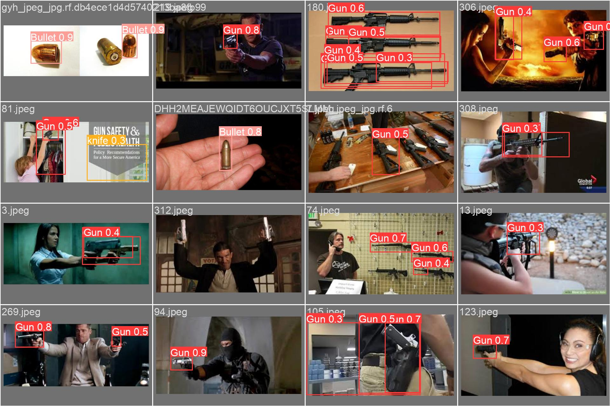
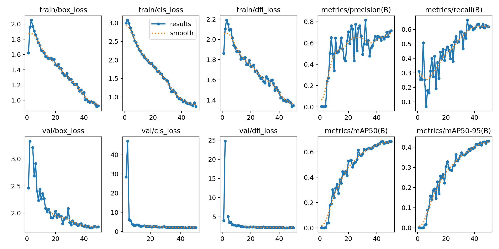

# YOLOv8 Fine-Tuning — Weapon Detection

Fine-tuning [Ultralytics YOLOv8](https://github.com/ultralytics/ultralytics) to detect **guns, bullets, hand axes, knives, and people** in images, videos, and a live webcam feed — plus a small GUI tool for adding new labelled data and classes to the dataset.

<p align="center">
  
</p>

## Results

YOLOv8-L fine-tuned for 50 epochs at 640×640 on the dataset in `Dataset/` (750 training / 495 validation images):

| Metric | Value |
|---|---|
| Precision | 0.715 |
| Recall | 0.618 |
| mAP@50 | **0.683** |
| mAP@50-95 | 0.430 |

Training curves, confusion matrices, and PR curves are in [`runs/detect/train2/`](runs/detect/train2).

<p align="center">
  
</p>

## Classes

`Gun` · `Bullet` · `Hand Axe` · `knife` · `Person` (defined in [`Dataset/data.yaml`](Dataset/data.yaml))

## Project structure

```
├── Dataset/            # YOLO-format images + labels and data.yaml
├── runs/detect/train2/ # Training run: metrics, plots, and weights (best.pt / last.pt)
├── train.py            # Fine-tune a YOLOv8 model on Dataset/
├── detect.py           # Run detection on an image or video
├── web_cam.py          # Real-time detection from the webcam
├── add_data.py         # Tkinter GUI to add new images/labels/classes to the dataset
├── utils.py            # data.yaml helpers
└── check_installation.py
```

## Getting started

```bash
pip install -r requirements.txt
python check_installation.py
```

Base YOLOv8 weights (e.g. `yolov8m.pt`, `yolov8l.pt`) are downloaded automatically by Ultralytics on first use.

### Train

```bash
python train.py yolov8l.pt
```

### Detect on an image or video

```bash
python detect.py path/to/image.jpg --confidence 0.3 --model runs/detect/train2/weights/best.pt
```

### Live webcam detection

```bash
python web_cam.py --model_path runs/detect/train2/weights/best.pt
```

### Add more data

```bash
python add_data.py
```

The GUI lets you register new class names in `data.yaml` and copy new images and YOLO-format labels into the train/validation split. Label IDs for new classes must continue from the current number of classes.

## License

[MIT](LICENSE)
